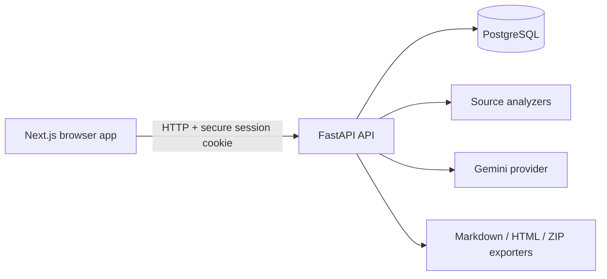

# API Documentation Generator

A project-based workspace for analyzing API examples and source files, generating documentation with Google Gemini, editing Markdown, keeping document versions, and sharing selected documents through read-only links.

> **Current implementation status:** this repository contains a runnable first implementation of the core platform. It includes account registration/login, PostgreSQL persistence, projects, source upload and static analysis, Gemini generation, document editing, version history, sharing links, Markdown/HTML export, project ZIP export, Docker startup, and initial tests. Features not implemented should not be inferred from the roadmap. See [docs/ROADMAP.md](docs/ROADMAP.md) for the current scope and limitations.

## Features

- Email/password registration and login with Argon2id password hashes and server-validated cookie sessions.
- Per-user private projects and documents, enforced by backend ownership checks.
- JSON structure analysis and static Python AST analysis without executing uploaded source code.
- Partial pattern-based JavaScript/TypeScript analysis and explicit partial-analysis notes.
- Gemini-powered Markdown generation, when `GEMINI_API_KEY` is configured.
- Manual Markdown editing with a live preview.
- Persistent document versions and restoration.
- Read-only share links with expiration, revocation, and optional download permission.
- Markdown, sanitized HTML, and PDF exports; project ZIP export.
- Docker Compose with PostgreSQL persistence and health checks.

## Quick start

### Prerequisites

- Docker Engine or Docker Desktop with Docker Compose v2.
- A terminal.
- A Gemini API key only if you want AI generation.

You do **not** need to install Python, Node.js, or PostgreSQL separately for the standard Docker path.

### Start the application

Open your Kali Linux terminal and use these commands from any directory.

### Start the project

```bash
cd ~/Desktop/api-documentation-generator
docker compose up -d
```

### Stop the project

```bash
cd ~/Desktop/api-documentation-generator
docker compose stop
```

This stops the containers without deleting your database or project data.

### Restart the project

```bash
cd ~/Desktop/api-documentation-generator
docker compose restart
```

### Check project status

```bash
cd ~/Desktop/api-documentation-generator
docker compose ps
```

### View logs

```bash
cd ~/Desktop/api-documentation-generator
docker compose logs -f
```

Press **Ctrl+C** to stop viewing the logs. This does not stop the project.

### Open the application

Once the services are running, visit:

* **Frontend:** [http://localhost:3000](http://localhost:3000)
* **API health check:** [http://localhost:8000/health/ready](http://localhost:8000/health/ready)

**Important:** Avoid `docker compose down --volumes` for normal stopping; it can delete your database data.


From the project root:

```bash
./scripts/start.sh
```

On the first run, the script creates `.env` from `.env.example`, fills blank application/database secrets, builds the images, starts services, waits for health checks, and applies database migrations as the API container starts. It does not overwrite existing `.env` settings.

On Windows, open PowerShell in the project directory and run:

```powershell
.\scripts\start.ps1
```

Open:

- Web application: http://localhost:3000
- Backend API: http://localhost:8000
- Interactive API reference: http://localhost:8000/docs
- Readiness check: http://localhost:8000/health/ready

Create an account from the registration page. Projects and documents are private to their owner unless a document is explicitly shared.

### Configure Gemini

1. Obtain an API key from Google AI Studio: https://aistudio.google.com/app/apikey
2. Stop or leave the app running, then edit `.env` in the repository root.
3. Set `GEMINI_API_KEY` to your key and, if necessary, set `GEMINI_MODEL` to a model available to your account.
4. Restart the backend:

```bash
docker compose --env-file .env up -d --force-recreate api
```

The application can still be used without a Gemini key for account management, projects, source analysis, manually authored documents, version history, sharing, and exports. AI generation returns a configuration message until the key is set.

Do not share or commit `.env`. Never put the Gemini key into a `NEXT_PUBLIC_*` variable.

## Common commands

```bash
# Follow service logs
docker compose --env-file .env logs -f

# Show service status
docker compose --env-file .env ps

# Stop containers but preserve database data
./scripts/stop.sh

# Rebuild and start after code changes
./scripts/start.sh

# Run backend unit tests locally (requires Python and API dependencies)
cd apps/api && pip install -e '.[test]' && pytest

# Create a PostgreSQL backup
./scripts/backup.sh

# Restore a backup (requires confirmation; can overwrite data)
./scripts/restore.sh backups/your-backup.sql.gz
```

`docker compose down -v` deletes the database volume and its data. Do not use it unless you intentionally want to remove the local database.

## Environment variables

| Variable | Purpose | Required |
|---|---|---|
| `APP_ENV` | Application environment | Has a development default; set `production` for deployment |
| `APP_SECRET_KEY` | Application secret reserved for secure application-level uses | Generated by startup script |
| `POSTGRES_DB` | Database name | Default `api_docs` |
| `POSTGRES_USER` | Database user | Default `app` |
| `DB_PASSWORD` | PostgreSQL password | Generated by startup script; keep secret |
| `GEMINI_API_KEY` | Backend-only Gemini API key | Optional; required for generation |
| `GEMINI_MODEL` | Gemini model identifier | Defaults to `gemini-2.5-flash`; verify availability for your account |
| `WEB_PORT` | Host port for the frontend | Default `3000` |
| `API_PORT` | Host port for the backend | Default `8000` |
| `API_INTERNAL_URL` | Internal API URL used by the Next.js same-origin proxy | Default `http://api:8000` in Docker Compose |
| `FRONTEND_URL` | Frontend origin | Default `http://localhost:3000` |
| `CORS_ORIGINS` | Comma-separated allowed browser origins | Default local frontend origin |
| `PUBLIC_APP_URL` | Base URL used when creating share links | Default local frontend origin |
| `SESSION_COOKIE_SECURE` | Set session cookies Secure when served over HTTPS | `false` locally; set `true` behind HTTPS in production |
| `MAX_UPLOAD_SIZE_MB` | Maximum source upload size | Default `5` |
| `LOG_LEVEL` | Backend log level | Default `INFO` |

The startup script only fills blank secrets; it will not replace values already present in `.env`.

## How to use it

1. Register and sign in.
2. Create a project for an API or codebase.
3. Upload a supported `.json`, `.py`, `.js`, `.ts`, `.yaml`, or `.yml` text file.
4. Review the source file list and select a file.
5. If Gemini is configured, generate a documentation draft. Otherwise create a blank document and write it manually.
6. Edit Markdown in the left pane and review the rendered preview on the right.
7. Save changes. Each meaningful save creates a document version.
8. Open **Versions** to inspect and restore earlier versions.
9. Open **Share** to create a read-only link. Revoke links when access should stop.
10. Export Markdown, HTML, or PDF, or export the whole project as a ZIP.

### Input support

- **JSON:** structured shape analysis of objects, arrays, and primitive values.
- **Python:** AST-based extraction of functions, parameters, return annotations, classes, and docstrings. Uploaded code is not executed.
- **JavaScript/TypeScript:** limited pattern-based extraction. This is not a complete language parser.
- **YAML:** accepted as text in this initial implementation; semantic OpenAPI YAML parsing is not implemented yet.

A JSON response alone cannot establish the real endpoint URL, HTTP method, authentication scheme, or response status. The generator is instructed to label missing details rather than invent them, but users should review AI output before publishing.

## Architecture



- `apps/web`: Next.js, React, TypeScript, and the workspace UI.
- `apps/api`: FastAPI routes, SQLAlchemy models, authentication, analyzers, Gemini integration, sharing, and exports.
- `apps/api/migrations`: Alembic database migrations.
- `compose.yaml`: local service orchestration.
- `scripts`: startup, shutdown, backup, and restore helpers.
- `docs`: architecture, security, database, deployment, roadmap, and troubleshooting notes.

## API reference

FastAPI publishes its interactive OpenAPI page at `http://localhost:8000/docs` in the default local configuration. All application API endpoints use `/api/v1/` except health endpoints. Browser requests use credentials and a CSRF header for state-changing requests.

## Database and persistence

PostgreSQL is the source of truth for users, sessions, projects, source text, documents, versions, generation metadata, and sharing links. The Compose file stores database data in the named `postgres_data` volume. Rebuilding containers does not remove that volume. Alembic applies the initial schema on API startup.

## Security notes

- Passwords are hashed using Argon2id.
- Session tokens are random and only their SHA-256 hashes are stored in the database.
- Backend routes enforce project/document ownership.
- CSRF tokens are required for state-changing cookie-authenticated requests.
- Share links use random tokens; only token hashes are stored.
- Markdown previews do not enable raw HTML.
- Uploaded source files are parsed as text and are not executed.
- The Gemini key is read only by the backend.

This is a first release and should receive a deployment-specific security review before being exposed publicly. Production deployment requires HTTPS, secure cookies, restricted CORS origins, protected secrets, backups, rate limiting appropriate to expected traffic, and monitoring. See [docs/SECURITY.md](docs/SECURITY.md).

## Production deployment

Do not expose this local Compose setup directly to the public internet without adapting it. Before production:

1. Set `APP_ENV=production`.
2. Use strong, unique secret values and protect `.env` or use a secrets manager.
3. Put the application behind a correctly configured HTTPS reverse proxy or platform ingress.
4. Set `SESSION_COOKIE_SECURE=true`.
5. Set `FRONTEND_URL`, `CORS_ORIGINS`, and `PUBLIC_APP_URL` to the correct public origins. Browser requests use a same-origin Next.js proxy (`/api/v1/*`), which avoids CORS and browser `localhost` address mismatches. Set `API_INTERNAL_URL` only if your API service has a different internal address.
6. Keep PostgreSQL on a private network and configure backups and restoration drills.
7. Review proxy trust, security headers, rate limits, allowed hosts, file limits, and operational logging.
8. Run tests and migrations as part of a controlled deployment process.

A local one-command startup is not the same as a fully provisioned public production deployment. Domain, TLS, secret storage, backups, and infrastructure still require deployment-specific configuration.

## Troubleshooting

- **Docker not running:** start Docker Desktop or the Docker daemon, then retry `./scripts/start.sh`.
- **Port already in use:** change `WEB_PORT` or `API_PORT` in `.env`, then rebuild/recreate services. If changing the browser-facing API port, also update `NEXT_PUBLIC_API_BASE_URL` and rebuild the web image.
- **Backend is not ready:** run `docker compose --env-file .env logs --tail=150 api db` and check the database credentials and migration output.
- **Gemini key missing:** add `GEMINI_API_KEY` to `.env` and recreate the API container.
- **Gemini permission error (403):** verify that the key and project can use the selected model.
- **Gemini rate limit/quota error (429):** wait, review the provider quota, and retry later.
- **Gemini unavailable (503):** retry after a short wait; provider availability is outside this application's control.
- **Share link fails:** check whether it was revoked or expired, and verify `PUBLIC_APP_URL` matches the address recipients use.
- **Cookie/session problems:** use the same hostname consistently (`localhost` vs `127.0.0.1` are different cookie hosts) and verify the configured CORS origin.
- **Restore failed:** check that the backup is a valid gzip-compressed SQL dump and that the target database is running.

## License

No license has been selected in this initial repository. Add an appropriate `LICENSE` file before distributing the project. Do not assume that code is permissively licensed simply because it is on GitHub.


## Gemini configuration (managed in the UI)

Sign in and open **Account settings**. Add or replace your Google Gemini API key, choose a supported model, and use **Test connection** to verify it. The key is encrypted in the database using a key derived from `APP_SECRET_KEY`; it is never returned to the browser after saving. Remove it from the same screen to disable AI generation for your account. Each account has its own Gemini key and model. The server's legacy `GEMINI_API_KEY` and `GEMINI_MODEL` environment variables are not used for document generation. Keep `APP_SECRET_KEY` stable and backed up: changing it makes previously encrypted keys unreadable, so affected users must save their keys again.
